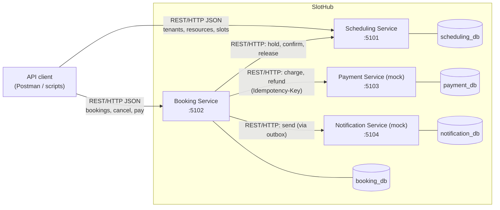
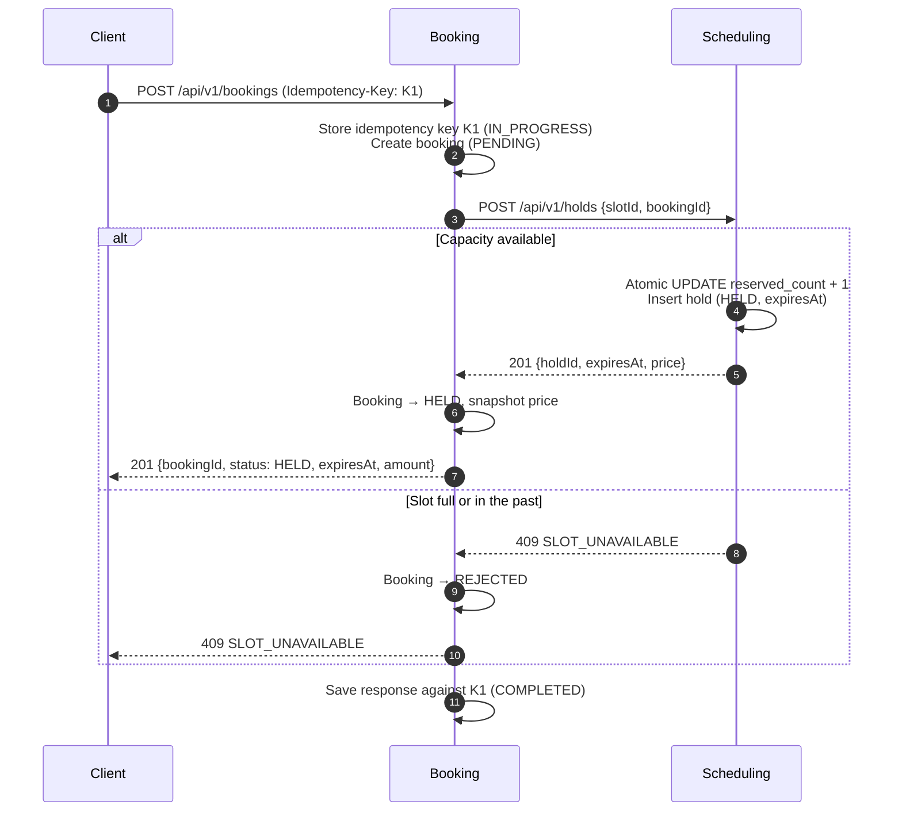
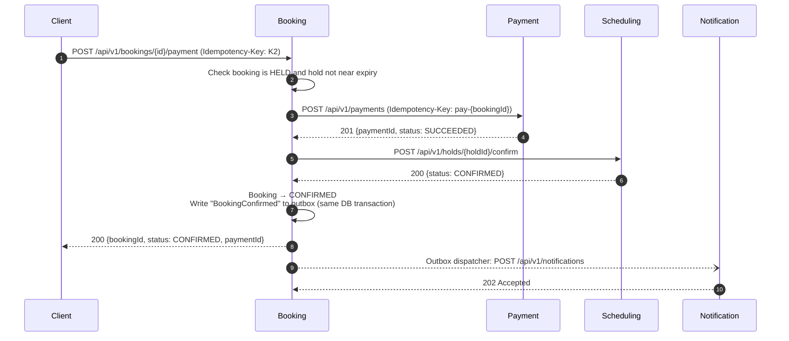
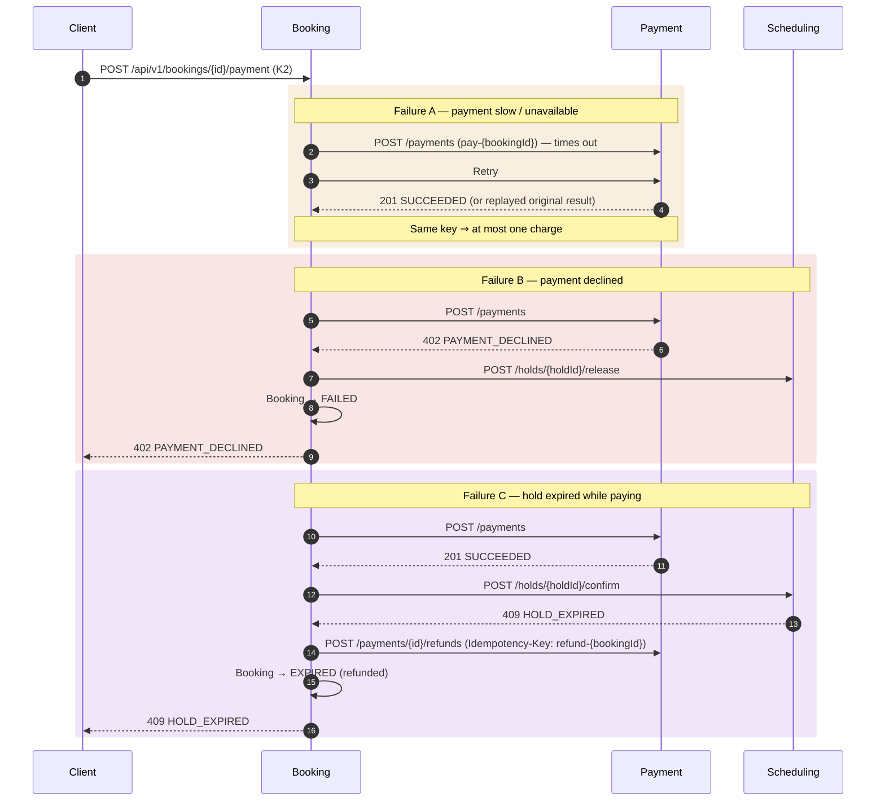
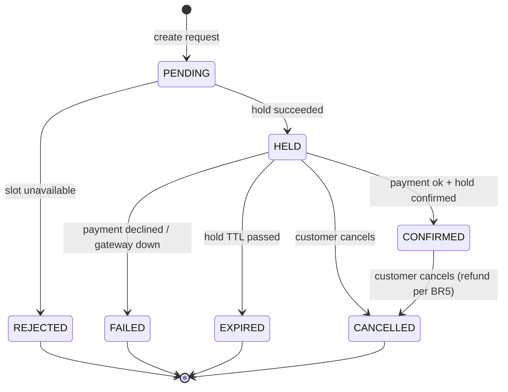
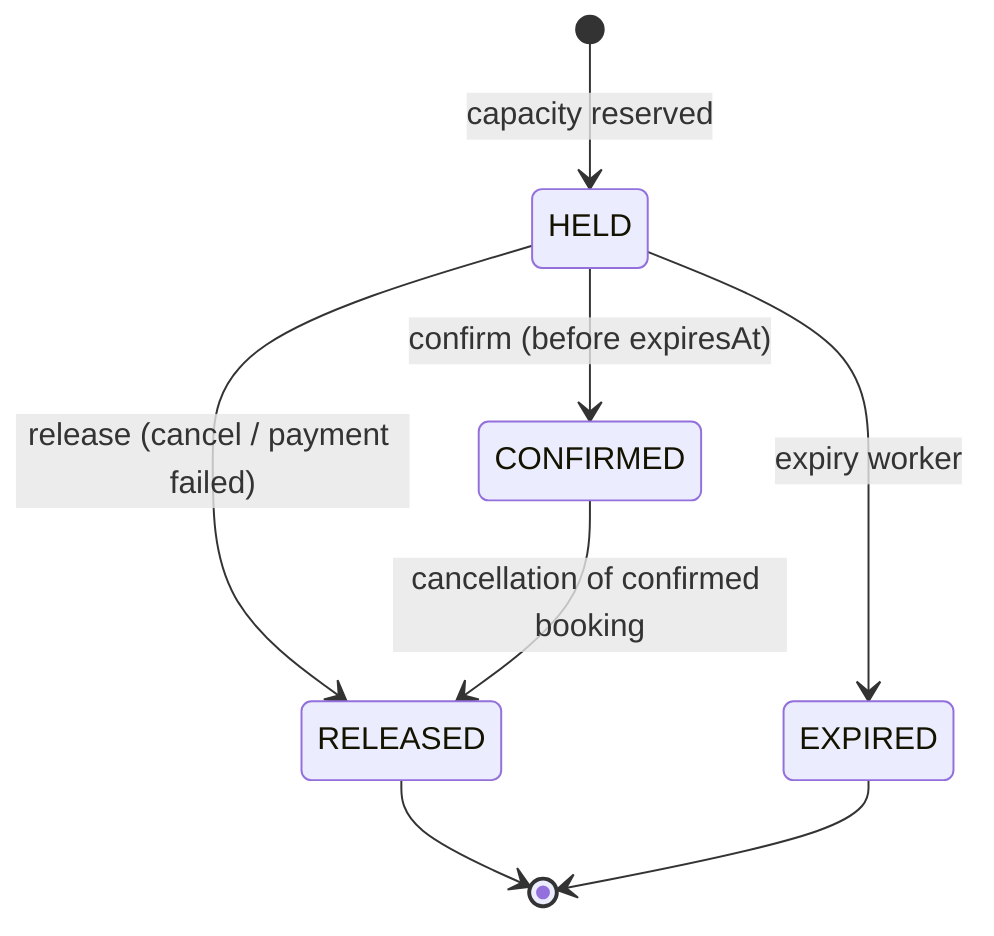
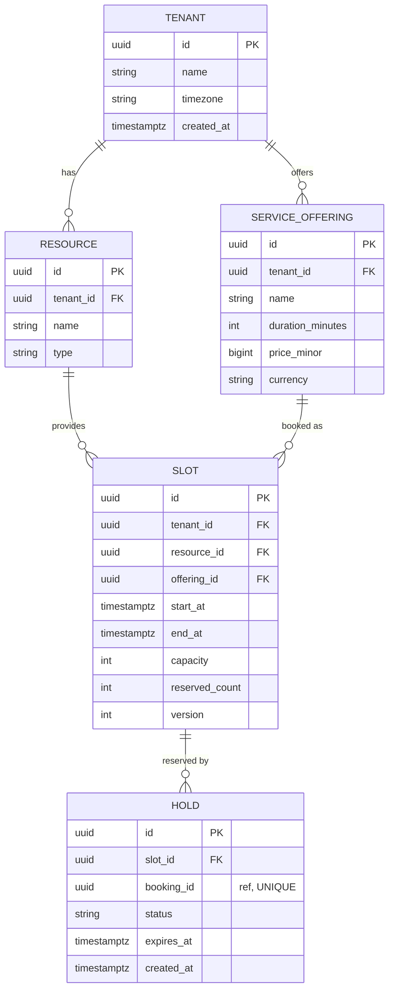
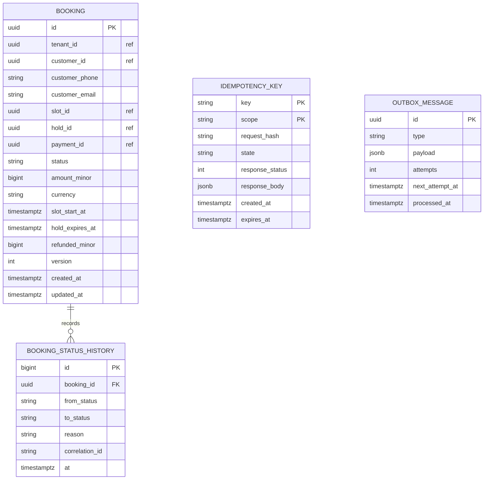
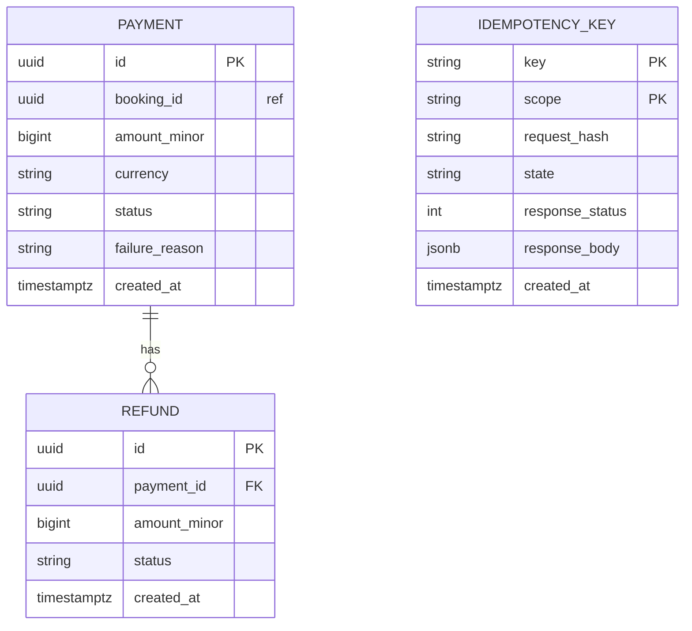
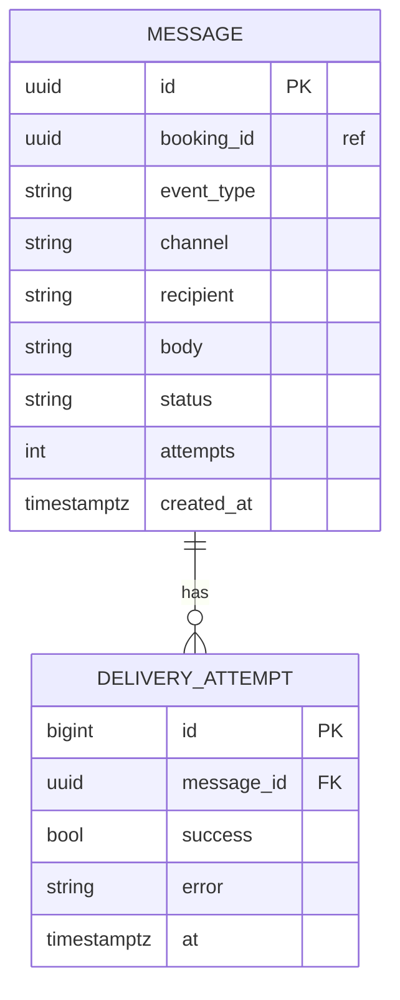

# SlotHub — Solution Architecture

> **SlotHub** (working name) is a multi-tenant slot booking platform. Any business that sells time — clinics, salons, sports turfs, tutors, coworking desks — publishes bookable slots; customers hold a slot, pay for it and receive a confirmation.
>
> Course: Scalable Services (SEZG583) — Assignment 1. Designed to be containerised in Assignment 2 (Docker, Minikube) and to grow into a production product afterwards.

| Item | Value |
|---|---|
| Status | Draft v0.1 |
| Stack | .NET 10 (C#), ASP.NET Core Web API, EF Core, PostgreSQL |
| Services | Scheduling, Booking, Payment (mock), Notification (mock) |
| Chosen Challenge 3 | **3B — Time-bound holds** |

---

## Contents

1. [Problem and scope](#1-problem-and-scope)
2. [Business rules](#2-business-rules)
3. [Service decomposition](#3-service-decomposition)
4. [Architecture](#4-architecture)
5. [Main transaction](#5-main-transaction)
6. [State machines](#6-state-machines)
7. [Data design](#7-data-design)
8. [API design](#8-api-design)
9. [Engineering challenges](#9-engineering-challenges)
10. [Cross-cutting concerns](#10-cross-cutting-concerns)
11. [Technology stack](#11-technology-stack)
12. [Solution and repository structure](#12-solution-and-repository-structure)
13. [Configuration, ports and environment variables](#13-configuration-ports-and-environment-variables)
14. [Testing strategy](#14-testing-strategy)
15. [Design decisions and trade-offs](#15-design-decisions-and-trade-offs)
16. [Scalability roadmap](#16-scalability-roadmap)
17. [Limitations and future work](#17-limitations-and-future-work)

---

## 1. Problem and scope

### 1.1 Problem
Small service businesses manage appointments by phone or spreadsheet. Double bookings, no-shows and unpaid reservations cost them money. SlotHub gives every business (a **tenant**) an online booking engine where:

- slots can never be over-booked, even under concurrent demand;
- a slot is held briefly while the customer pays, and released automatically if they don't;
- a customer is never charged twice, even if they retry or double-tap.

### 1.2 Actors

| Actor | Description |
|---|---|
| Tenant | A business using SlotHub (e.g. "Sunrise Dental Clinic") |
| Resource | The thing being booked: a doctor, a turf court, a yoga class |
| Customer | The person who books and pays |
| Operator | Runs the platform; uses admin/chaos endpoints in the demo |

### 1.3 Assumptions
- A slot has a fixed start/end time and a **capacity** (1 for a doctor, N for a group class).
- Prices are fixed per service offering; the price is **snapshotted** onto the booking at hold time.
- Currency is INR; amounts are stored as integer minor units (paise).
- Customers are identified by an ID plus contact details passed in the request (no customer service, no auth).
- All times are stored in UTC.

### 1.4 Out of scope (Assignment 1)
- Authentication / authorisation (tenant isolation is enforced by `tenantId` on data, not by identity).
- UI — a Postman collection and scripts are the client.
- Real payment or SMS integration — both are mock services with configurable failure.
- Recurring bookings, waitlists, discounts, reviews (see [§17](#17-limitations-and-future-work)).

---

## 2. Business rules

| ID | Rule | Owner service | Enforced in (planned) | Test (planned) |
|---|---|---|---|---|
| **BR1** | A slot can never have more active (held + confirmed) reservations than its capacity. | Scheduling | Atomic conditional `UPDATE` in `SlotRepository.TryReserveAsync` | `SlotCapacityTests`, concurrency script |
| **BR2** | A hold expires after `HOLD_TTL_SECONDS` (default 30 s in demo) if not confirmed; its capacity is released. A confirmed hold is never released by expiry. | Scheduling | `HoldExpiryWorker`, `Hold.Expire()` | `HoldExpiryTests` |
| **BR3** | A booking can be confirmed only after a successful payment **and** while its hold is still active. Payment that succeeds after the hold expired is refunded automatically. | Booking | `BookingStateMachine`, `PayBookingHandler` | `BookingConfirmationTests` |
| **BR4** | The same `Idempotency-Key` with the same payload returns the original response with no new side effect; the same key with a different payload is rejected with `422`. | Booking, Payment | `IdempotencyFilter` + `idempotency_keys` table | `IdempotencyTests`, idempotency script |
| **BR5** | Cancellation refund policy: ≥ 24 h before slot start → 100 %; < 24 h → 50 %; after start → cancellation not allowed. | Booking | `RefundPolicy.Calculate()` | `RefundPolicyTests` |
| **BR6** | A slot whose start time is in the past cannot be held. | Scheduling | `Slot.CanBeHeld(now)` + `WHERE start_at > now()` | `SlotHoldRulesTests` |
| BR7 *(optional)* | A customer may have at most 2 active holds per tenant at a time (anti-hoarding). | Booking | `CustomerHoldLimit` | `CustomerHoldLimitTests` |

Every rule lives in the **Domain** project of its owner service, so it can be unit-tested without HTTP or a database.

---

## 3. Service decomposition

### 3.1 Responsibility table

| Service | One-sentence responsibility | Owns (data) | Does **not** own |
|---|---|---|---|
| **Scheduling** | Defines what a tenant offers and when, and controls how much of each slot is left. | Tenants, resources, service offerings, prices, slots, holds | Bookings, payments, customer contacts |
| **Booking** | Takes a customer's booking from request to confirmation or cancellation, orchestrating the other services. | Bookings, status history, booking idempotency keys, notification outbox | Slot capacity, money movement |
| **Payment** *(mock gateway)* | Charges and refunds money exactly once per request. | Payments, refunds, payment idempotency keys, chaos settings | Why a payment was made (only references `bookingId`) |
| **Notification** *(mock SMS/email)* | Delivers customer messages and retries failed deliveries without sending duplicates. | Messages, delivery attempts, templates, chaos settings | Booking state |

### 3.2 Why these boundaries
- **Scheduling = catalog + availability.** A service's duration defines how slots are cut, and a resource's schedule only makes sense next to the resource. Splitting them would force two services to change together on every schedule change — a distributed monolith smell.
- **Booking is the only orchestrator.** It is the one place that knows the end-to-end flow and its state machine; other services expose simple, reusable capabilities (hold, charge, notify).
- **Payment is separate** because it is an external-style dependency that can be slow or fail (assignment condition *e*), and because money needs its own idempotency and audit trail.
- **Notification is separate** because its failure must never affect booking correctness, and because channels (SMS, email, WhatsApp) will multiply independently.

### 3.3 Alternatives rejected

| Alternative | Why rejected |
|---|---|
| Separate Catalog and Availability services | Change together; adds a network hop to every booking. Can be split later if catalog reads dominate. |
| Payment logic inside Booking | Loses the slow/failing dependency boundary and the second idempotency layer that prevents double charges. |
| Choreography via events only | Harder to see and test the flow in Assignment 1; compensation logic scattered across services. Kept as a future step (§16). |
| A "Customer" service | No auth or profile features are in scope; it would be a CRUD wrapper. |

---

## 4. Architecture

### 4.1 Component diagram



- Scheduling and Payment calls use synchronous REST over HTTP with JSON bodies and `X-Correlation-Id`.
- Notification delivery is dispatched asynchronously through Booking's transactional outbox.
- No service reads another service's database. Each database has its own credentials.
- The longest call chain in one user request is **Client → Booking → {Scheduling | Payment}** (depth 2). Booking calls downstream services one after another, never through each other.

### 4.2 Internal service layout
Every service uses the same three-layer structure:

```
<Service>.Api             HTTP endpoints, validation, ProblemDetails, middleware, DI
<Service>.Domain          Entities, value objects, state machines, business rules (pure C#)
<Service>.Infrastructure  EF Core DbContext, repositories, migrations, HTTP clients, background workers
```

Dependencies point inwards: `Api → Domain`, `Infrastructure → Domain`. The Domain project has no reference to EF Core or ASP.NET Core.

---

## 5. Main transaction

The booking is a **two-step checkout**, as in a real product: the customer first holds a slot, then pays for it. This gives the hold a real lifetime (needed for Challenge 3B) and spans all four services.

### 5.1 Step 1 — Create booking (hold the slot)



### 5.2 Step 2 — Pay for booking (happy path)



### 5.3 Failure paths



If Booking crashes between hold and payment, nothing is lost: the hold **auto-expires** in Scheduling (BR2) and capacity returns.

### 5.4 Cancellation
`POST /api/v1/bookings/{id}/cancel`
- `HELD` → release hold → `CANCELLED` (no money moved).
- `CONFIRMED` → compute refund (BR5) → refund via Payment → release confirmed hold via Scheduling → `CANCELLED`.

---

## 6. State machines

Transitions not shown are rejected with `409 INVALID_STATE_TRANSITION`. Each state machine is a single class in the Domain project.

### 6.1 Booking (Booking service)



### 6.2 Hold (Scheduling service)



`RELEASED` and `EXPIRED` give the capacity back. The expiry worker only touches holds in `HELD`.

### 6.3 Payment (Payment service)
`PENDING → SUCCEEDED | FAILED`, `SUCCEEDED → PARTIALLY_REFUNDED | REFUNDED`. Total refunds can never exceed the charged amount.

### 6.4 Notification message (Notification service)
`PENDING → SENT | FAILED_RETRYING → SENT | DEAD` (after `NOTIFY_MAX_ATTEMPTS`).

---

## 7. Data design

Each service has its own PostgreSQL database and its own database user. There are **no foreign keys across services**; cross-service references are stored as plain UUIDs (shown as `*_id` with no relationship line).

### 7.1 Scheduling — `scheduling_db`



Constraints: `CHECK (reserved_count >= 0 AND reserved_count <= capacity)`; `UNIQUE (booking_id)` on `HOLD` so a retried hold request for the same booking cannot reserve twice.

### 7.2 Booking — `booking_db`



### 7.3 Payment — `payment_db`



### 7.4 Notification — `notification_db`



`UNIQUE (booking_id, event_type, channel)` on `MESSAGE` suppresses duplicate notifications.

### 7.5 Data ownership and cross-service references

| Data | Owner | Referenced by | How |
|---|---|---|---|
| Slot, hold, price | Scheduling | Booking | `slot_id`, `hold_id` + price snapshot copied at hold time |
| Booking | Booking | Scheduling, Payment, Notification | `booking_id` stored as opaque UUID |
| Payment | Payment | Booking | `payment_id` |
| Message | Notification | — | — |

Rules: a service never joins across databases; it copies the few fields it needs at the moment of the transaction (e.g. price, slot start time) and treats them as a **snapshot**, not a live value.

---

## 8. API design

All paths are versioned under `/api/v1`. Every service exposes `GET /health` and an OpenAPI document at `/openapi/v1.json` (UI at `/scalar`).

### 8.1 Scheduling (`:5101`)

| Method | Path | Purpose | Success |
|---|---|---|---|
| POST | `/api/v1/tenants` | Create tenant | 201 |
| GET | `/api/v1/tenants/{tenantId}` | Get tenant | 200 |
| POST | `/api/v1/tenants/{tenantId}/resources` | Add resource | 201 |
| GET | `/api/v1/tenants/{tenantId}/resources` | List resources | 200 |
| POST | `/api/v1/tenants/{tenantId}/offerings` | Add service offering | 201 |
| GET | `/api/v1/tenants/{tenantId}/offerings` | List offerings | 200 |
| POST | `/api/v1/slots` | Create slots (batch) for a resource and offering | 201 |
| GET | `/api/v1/slots?tenantId=&resourceId=&from=&to=&available=true` | Search slots | 200 |
| GET | `/api/v1/slots/{slotId}` | Get slot incl. remaining capacity | 200 |
| POST | `/api/v1/holds` | Hold one unit of a slot for a booking | 201 / 409 |
| GET | `/api/v1/holds/{holdId}` | Get hold | 200 |
| POST | `/api/v1/holds/{holdId}/confirm` | Confirm hold | 200 / 409 |
| POST | `/api/v1/holds/{holdId}/release` | Release hold | 200 / 409 |

### 8.2 Booking (`:5102`)

| Method | Path | Purpose | Success | Notes |
|---|---|---|---|---|
| POST | `/api/v1/bookings` | Create booking and hold slot | 201 | `Idempotency-Key` required |
| GET | `/api/v1/bookings/{bookingId}` | Get booking | 200 | |
| GET | `/api/v1/bookings?customerId=&status=` | List bookings | 200 | |
| POST | `/api/v1/bookings/{bookingId}/payment` | Pay and confirm | 200 | `Idempotency-Key` required |
| POST | `/api/v1/bookings/{bookingId}/cancel` | Cancel (refund per BR5) | 200 | `Idempotency-Key` required |

### 8.3 Payment (`:5103`)

| Method | Path | Purpose | Success |
|---|---|---|---|
| POST | `/api/v1/payments` | Charge | 201 / 402 |
| GET | `/api/v1/payments/{paymentId}` | Get payment | 200 |
| POST | `/api/v1/payments/{paymentId}/refunds` | Refund (full or partial) | 201 |
| PUT | `/api/v1/admin/chaos` | Set `failureRate`, `latencyMs` for demo | 204 |

### 8.4 Notification (`:5104`)

| Method | Path | Purpose | Success |
|---|---|---|---|
| POST | `/api/v1/notifications` | Queue a message | 202 |
| GET | `/api/v1/notifications?bookingId=` | List messages and status | 200 |
| PUT | `/api/v1/admin/chaos` | Set provider `failureRate`, `latencyMs` | 204 |

### 8.5 Sample request and response

```http
POST /api/v1/bookings HTTP/1.1
Host: localhost:5102
Content-Type: application/json
Idempotency-Key: 7d9f1c2e-4b8a-4f0e-9a51-2c3e6f1d8b70
X-Correlation-Id: demo-001

{
  "tenantId": "0b6c...e1",
  "slotId": "a41f...9c",
  "customer": { "id": "c-1001", "phone": "+919800000001", "email": "priya@example.com" }
}
```

```http
HTTP/1.1 201 Created
Location: /api/v1/bookings/5e2b...77
X-Correlation-Id: demo-001

{
  "id": "5e2b...77",
  "status": "HELD",
  "slotId": "a41f...9c",
  "holdExpiresAt": "2026-11-02T04:30:30Z",
  "amount": { "minor": 50000, "currency": "INR" }
}
```

### 8.6 Error model
All services return **RFC 9457 Problem Details** (`application/problem+json`) with two extensions: a stable machine-readable `code` and the `correlationId`.

```json
{
  "type": "https://slothub.dev/errors/slot-unavailable",
  "title": "Slot unavailable",
  "status": 409,
  "detail": "Slot a41f...9c has no remaining capacity.",
  "instance": "/api/v1/bookings",
  "code": "SLOT_UNAVAILABLE",
  "correlationId": "demo-001",
  "errors": null
}
```

| Status | When | Example `code` |
|---|---|---|
| 400 | Validation failed (FluentValidation); `errors` lists fields | `VALIDATION_FAILED` |
| 404 | Entity not found | `BOOKING_NOT_FOUND` |
| 402 | Payment declined by gateway | `PAYMENT_DECLINED` |
| 409 | Capacity exhausted, invalid state transition, hold expired, idempotent request still in progress, booking being changed by another request | `SLOT_UNAVAILABLE`, `INVALID_STATE_TRANSITION`, `HOLD_EXPIRED`, `REQUEST_IN_PROGRESS`, `BOOKING_BUSY` |
| 422 | Idempotency key reused with a different payload | `IDEMPOTENCY_KEY_MISMATCH` |
| 503 | Downstream unavailable after retries / circuit open | `DOWNSTREAM_UNAVAILABLE`, `PAYMENT_GATEWAY_UNAVAILABLE`, `DOWNSTREAM_CIRCUIT_OPEN` |
| 504 | Downstream timed out after retries | `DOWNSTREAM_TIMEOUT` |

---

## 9. Engineering challenges

### 9.1 Challenge 1 — Concurrency control (Scheduling, BR1)

**Problem.** 20 customers try to hold the same slot (capacity *N*) at the same instant.

**Why check-then-update fails.** Code like `if (slot.Reserved < slot.Capacity) { slot.Reserved++; Save(); }` lets two requests both read `Reserved = 0`, both pass the check, and both write `Reserved = 1` — two holds for one seat (lost update). The check and the write are not atomic.

**Design choice — atomic conditional update.** The check and the increment happen in one SQL statement; PostgreSQL row-locks the slot for the duration of the statement, so concurrent requests serialise on that row:

```sql
UPDATE slots
SET    reserved_count = reserved_count + 1, version = version + 1
WHERE  id = @slotId
  AND  reserved_count < capacity
  AND  start_at > now()          -- BR6
RETURNING reserved_count;
```

0 rows affected ⇒ `409 SLOT_UNAVAILABLE`. The `HOLD` insert runs in the same DB transaction. A `CHECK (reserved_count <= capacity)` constraint is a second line of defence.

**Alternatives considered.**

| Option | Verdict |
|---|---|
| `SELECT ... FOR UPDATE` then update | Correct, but two round-trips and longer lock time |
| Optimistic locking (`version` / `xmin`) | Correct, but under heavy contention most requests fail and must retry |
| One row per seat + unique constraint | Good for numbered seats; overkill for capacity counts |
| Distributed lock (Redis) | Extra infrastructure; the database is already the source of truth |

**Evidence plan.** `scripts/challenge1-concurrency.sh` fires 20+ parallel `POST /holds` (or `POST /bookings`) for capacity 1 and 5; asserts exactly *N* × `201`, rest `409`; dumps `slots` and `holds` rows afterwards.

### 9.2 Challenge 2 — Idempotency (Booking and Payment, BR4)

**Problem.** A client retries `POST /bookings/{id}/payment` after a timeout, or double-taps "Pay". There must be at most one booking and one charge.

**Design.**
1. Client sends `Idempotency-Key`. The server computes `request_hash = SHA-256(method + path + canonical JSON body)`.
2. In its own transaction the server **inserts** `(key, scope, request_hash, state = IN_PROGRESS)`. The primary key `(key, scope)` makes the insert itself the lock:
   - Insert succeeds ⇒ this request owns the key; process it.
   - Unique violation ⇒ read the existing row:
     - different `request_hash` ⇒ `422 IDEMPOTENCY_KEY_MISMATCH`;
     - `COMPLETED` ⇒ replay stored status + body (header `Idempotency-Replayed: true`);
     - `IN_PROGRESS` ⇒ `409 REQUEST_IN_PROGRESS` with `Retry-After: 1`.
3. On completion, store `response_status` and `response_body` and set `state = COMPLETED`.

This handles **two identical requests arriving at the same moment**: only one insert can win the unique constraint.

**Two layers.** Booking derives a deterministic key for its downstream calls — `pay-{bookingId}` to Payment and `refund-{bookingId}` for refunds — so Booking's own retries can never double-charge, even if Booking's idempotency record is lost.

**Implementation.** An ASP.NET Core endpoint filter `[Idempotent]` in `BuildingBlocks`, backed by each service's own `idempotency_keys` table (no shared store). Keys expire after 24 h.

**Evidence plan.** `scripts/challenge2-idempotency`: first call vs. repeated calls (same output), same key + different body (`422`), 10 parallel identical calls (one `201`, the rest replay or `409`), logs showing `Idempotency replay`, and a `SELECT` showing one booking and one payment.

### 9.3 Challenge 3B — Time-bound holds (Scheduling, BR2)

**Problem.** A held slot must be released automatically if the customer does not pay within `HOLD_TTL_SECONDS` (30 s in the demo). Cancellation must also release it. The expiry job must be safe to run twice and must never release a paid slot.

**Design.**
- Each hold stores `expires_at = now() + TTL`.
- `HoldExpiryWorker` (`BackgroundService`) runs every `HOLD_SWEEP_INTERVAL_SECONDS` and, per batch, in one transaction:

```sql
WITH expired AS (
  SELECT id, slot_id FROM holds
  WHERE  status = 'HELD' AND expires_at <= now()
  ORDER  BY expires_at
  LIMIT  100
  FOR UPDATE SKIP LOCKED
)
UPDATE holds h SET status = 'EXPIRED'
FROM   expired e WHERE h.id = e.id
RETURNING e.slot_id;
-- then: UPDATE slots SET reserved_count = reserved_count - n ... for each returned slot_id
```

**Why it is safe.**
- **Idempotent:** it only selects `status = 'HELD'`. A second run finds nothing to do, so capacity is never released twice.
- **Never releases a paid slot:** `confirm` is `UPDATE holds SET status='CONFIRMED' WHERE id=@id AND status='HELD' AND expires_at > now()`. Confirm and expiry race on the same row; exactly one wins. A confirmed hold is never `HELD` again.
- **Multi-instance safe:** `FOR UPDATE SKIP LOCKED` lets several Scheduling replicas run the worker (Assignment 2) without blocking or double-processing.
- **Payment that lands after expiry** is refunded by Booking (Failure C in §5.3, BR3).

Booking treats Scheduling as the source of truth for holds: a background reconciler picks HELD bookings whose `hold_expires_at` has passed, asks Scheduling for the hold, and moves the booking to EXPIRED (refunding any charge) once the hold is EXPIRED/RELEASED, or to CONFIRMED if the hold was confirmed but Booking crashed before saving. Payment attempts that arrive within `HOLD_SAFETY_MARGIN_SECONDS` of expiry are refused before charging. Pay, cancel and reconciliation on the same booking are serialised by a short per-booking lease (`locked_until`, conditional UPDATE), so they never interleave.

**Evidence plan.** `scripts/challenge3b-holds`: create hold → wait 35 s → slot capacity restored, hold `EXPIRED`; run worker twice → no change; confirm then wait → still `CONFIRMED`; cancel a hold → released immediately.

### 9.4 Resilience (applied, not the chosen Challenge 3)
Calls from Booking to Scheduling and Payment use the .NET resilience pipeline (Polly): per-attempt timeout 2 s, 3 retries with exponential backoff + jitter on timeouts/5xx, and a circuit breaker (opens at ≥ 50 % failures over ≥ 5 calls in 30 s, for 15 s; open-circuit calls fail fast with `DOWNSTREAM_CIRCUIT_OPEN`). Retries are safe because every unsafe downstream call is idempotent (holds unique per booking, `pay-{bookingId}` / `refund-{bookingId}` keys). Payment always finishes an in-flight charge even if Booking's attempt timed out; Booking's retry receives `409 REQUEST_IN_PROGRESS`, polls, and then gets the stored result replayed. Notification calls go through the outbox with their own retry schedule.

---

## 10. Cross-cutting concerns

| Concern | Approach |
|---|---|
| Health | `GET /health` (liveness) and `GET /health/ready` (checks the service's DB). Ready for Kubernetes probes in Assignment 2. |
| Configuration | Only environment variables (ASP.NET Core `__` convention). `.env.example` per service. No secrets in code. |
| Logging | Serilog, JSON to stdout, enriched with `service`, `correlationId`, `tenantId`, `bookingId`. |
| Correlation ID | Middleware reads `X-Correlation-Id` or generates one; pushes it into the log context; a `DelegatingHandler` adds it to every outgoing `HttpClient` call; echoed in responses and in Problem Details. |
| Validation | FluentValidation per request DTO → `400` Problem Details with field errors. |
| Errors | One global exception handler maps domain exceptions to Problem Details (§8.6). |
| Time | `TimeProvider` injected everywhere, so hold expiry and refund-policy tests can control the clock. |
| Database migrations | EF Core migrations per service, applied on startup in Development (`DB_MIGRATE_ON_STARTUP=true`). |
| Shared code | `BuildingBlocks` library with **cross-cutting code only** (correlation, Problem Details, idempotency filter, health). No domain types are shared. |

---

## 11. Technology stack

| Concern | Choice |
|---|---|
| Runtime | .NET 10 (LTS), C# |
| Web | ASP.NET Core Web API (controllers or minimal APIs, consistent across services) |
| Data access | EF Core 10 + Npgsql; raw SQL for the atomic hold and expiry statements |
| Database | PostgreSQL 17 — one database and one user per service |
| Validation | FluentValidation |
| API docs | `Microsoft.AspNetCore.OpenApi` + Scalar UI |
| Resilience | `Microsoft.Extensions.Http.Resilience` (Polly v8) |
| Logging | Serilog (`Serilog.AspNetCore`, compact JSON formatter) |
| Background jobs | `BackgroundService` (Hangfire/Quartz later if needed) |
| Tests | xUnit (plain asserts, no paid-licence libraries), Testcontainers for PostgreSQL |
| Scripts | PowerShell 7 / Bash + `curl`, or a small .NET console runner for parallel requests |
| Local infra | Docker Compose for PostgreSQL (services runnable with `dotnet run`) |

---

## 12. Solution and repository structure

```
slothub/
├── README.md                       how to run, ports, env vars, how to test
├── SlotHub.slnx                    single solution covering every project (each service also builds alone)
├── docker-compose.yml              PostgreSQL with 4 databases / 4 users (host port 5440)
├── docs/
│   ├── solution-architecture.md    this document
│   ├── product-backlog.md          agile sprint plan and backlog
│   ├── diagrams/                   exported Mermaid / draw.io
│   ├── openapi/                    scheduling.json, booking.json, payment.json, notification.json
│   └── report/                     final PDF
├── shared/
│   └── BuildingBlocks/             correlation, ProblemDetails, idempotency, health
├── services/
│   ├── scheduling/
│   │   ├── src/Scheduling.Api/
│   │   ├── src/Scheduling.Domain/
│   │   ├── src/Scheduling.Infrastructure/
│   │   ├── tests/Scheduling.UnitTests/
│   │   └── .env.example
│   ├── booking/        (same layout)
│   ├── payment/        (same layout)
│   └── notification/   (same layout)
├── scripts/
│   ├── seed.sh                     creates a tenant, resource, offering, slots
│   ├── e2e-booking.sh              main transaction end to end
│   ├── challenge1-concurrency.sh
│   ├── challenge2-idempotency.sh
│   └── challenge3b-holds.sh
├── postman/SlotHub.postman_collection.json
└── evidence/
    ├── challenge-1-concurrency/
    ├── challenge-2-idempotency/
    ├── challenge-3b-holds/
    └── tests/
```

---

## 13. Configuration, ports and environment variables

| Service | Port | Database | DB user |
|---|---|---|---|
| Scheduling | 5101 | `scheduling_db` | `scheduling_user` |
| Booking | 5102 | `booking_db` | `booking_user` |
| Payment | 5103 | `payment_db` | `payment_user` |
| Notification | 5104 | `notification_db` | `notification_user` |

| Variable | Service | Example | Purpose |
|---|---|---|---|
| `ASPNETCORE_URLS` | all | `http://0.0.0.0:5102` | Listen address |
| `ConnectionStrings__Default` | all | `Host=localhost;Database=booking_db;Username=booking_user;Password=...` | Own DB only |
| `DB_MIGRATE_ON_STARTUP` | all | `true` | Apply EF migrations at startup |
| `Services__Scheduling__BaseUrl` | Booking | `http://localhost:5101` | Downstream URL |
| `Services__Payment__BaseUrl` | Booking | `http://localhost:5103` | Downstream URL |
| `Services__Notification__BaseUrl` | Booking | `http://localhost:5104` | Downstream URL |
| `Http__TimeoutSeconds` / `Http__MaxRetries` | Booking | `2` / `3` | Resilience pipeline |
| `HOLD_TTL_SECONDS` | Scheduling | `30` | BR2 hold lifetime |
| `HOLD_SWEEP_INTERVAL_SECONDS` | Scheduling, Booking | `5` | Expiry worker period |
| `HOLD_SAFETY_MARGIN_SECONDS` | Booking | `3` | Refuse to charge if hold expires sooner |
| `IDEMPOTENCY_TTL_HOURS` | Booking, Payment | `24` | Key retention |
| `CHAOS_FAILURE_RATE` / `CHAOS_LATENCY_MS` | Payment, Notification | `0.3` / `3000` | Mock failure injection |
| `NOTIFY_MAX_ATTEMPTS` | Notification | `5` | Delivery retries |
| `Serilog__MinimumLevel__Default` | all | `Information` | Log level |

---

## 14. Testing strategy

| Level | What | Tooling |
|---|---|---|
| Unit | One or more tests per business rule (BR1–BR6), state machine transitions, refund policy, idempotency hash | xUnit, fake `TimeProvider` |
| Integration | Repository SQL (atomic hold, expiry worker, idempotency insert) against real PostgreSQL | Testcontainers |
| End-to-end | `scripts/e2e-booking.sh`: seed → create booking → pay → confirm → notification sent; plus one failure (payment declined) | Bash/PowerShell + curl |
| Challenge scripts | Concurrency, idempotency, holds — produce output files into `/evidence` | Scripts above |

Traceability: each test name references its rule, e.g. `BR1_Hold_IsRejected_WhenCapacityExhausted`.

---

## 15. Design decisions and trade-offs

| # | Decision | Options | Choice and rationale |
|---|---|---|---|
| D1 | Number of services | 5 (separate Catalog) vs 4 | **4.** Catalog and availability change together; fewer hops per booking; can split later. |
| D2 | Coordination style | Orchestration vs choreography | **Orchestration in Booking.** Flow and compensation are explicit and testable in one place; choreography adds a broker and scattered logic. |
| D3 | Communication | Sync REST vs async messaging | **Sync REST** for hold/pay/confirm (customer waits for the answer); **outbox + async dispatch** for notifications so their failure never blocks a booking. Outbox maps directly to RabbitMQ later. |
| D4 | Concurrency mechanism | Pessimistic lock, optimistic version, atomic conditional update | **Atomic conditional update.** Single statement, shortest lock, no retry storm under contention. |
| D5 | Idempotency storage | In-memory, Redis, per-service DB table | **Per-service DB table.** Survives restarts, works across replicas, keeps database-per-service, no extra infrastructure. |
| D6 | Checkout shape | One-shot `POST /bookings` vs hold-then-pay | **Hold-then-pay.** Mirrors real payment pages, gives holds a real lifetime (3B) and makes the failure paths visible. |
| D7 | Multi-tenancy | Separate DB per tenant vs shared schema with `tenant_id` | **Shared schema + `tenant_id`** on every row. Cheapest to run; can move large tenants to dedicated DBs later. |
| D8 | Shared library | Copy code per service vs `BuildingBlocks` | **BuildingBlocks for cross-cutting code only.** Avoids duplication without coupling domain models. |
| D9 | Serialising operations on one booking | DB row lock across HTTP calls, optimistic version only, short lease | **Lease (`locked_until`) + optimistic `version`.** No database lock is held while calling other services; a crashed operation's lease simply expires. |
| D10 | Expiry knowledge in Booking | Own timer, callback from Scheduling, ask Scheduling | **Ask Scheduling (reconciler).** Avoids two clocks disagreeing: Booking never expires a booking whose hold Scheduling has just confirmed. |

---

## 16. Scalability roadmap

| Stage | Change | Benefit |
|---|---|---|
| Assignment 2 | Dockerfile per service, Docker Compose, Minikube manifests, readiness/liveness probes, ConfigMaps/Secrets from the same env vars | Containerised, horizontally scalable |
| Next | API gateway (YARP) for routing, rate limiting, auth | Single entry point |
| Next | Authentication (OpenID Connect) with tenant claims | Real tenant isolation |
| Next | RabbitMQ via MassTransit: outbox publishes `BookingConfirmed`, `BookingCancelled`, `HoldExpired` events | Loose coupling, new consumers (analytics, CRM) without touching Booking |
| Scale | Scale Scheduling replicas independently (hottest service); read replicas or cache for slot search | Handles booking spikes |
| Scale | OpenTelemetry tracing + metrics (Grafana/Prometheus) | Production observability |
| Product | Real gateways (Razorpay/Stripe, WhatsApp/SMS) behind the existing Payment/Notification APIs | No change to Booking |
| Product | New services: Waitlist, Memberships, Pricing/Discounts, Reviews, Analytics | Business growth by adding, not rewriting |

---

## 17. Limitations and future work

- No authentication; `tenantId` and `customerId` are trusted from the request.
- Synchronous orchestration means Booking availability depends on Scheduling and Payment being up (mitigated by timeouts, retries and circuit breaker).
- The refund on late payment (Failure C) is best-effort; if Payment is down at that moment, the refund must be retried (future: move refunds into the outbox).
- Slots are created explicitly; generating them from recurring schedules is future work.
- BR7 (hold limit per customer) needs its own concurrency control and is optional for Assignment 1.
- Single PostgreSQL server hosting four databases locally; separate instances per service in Assignment 2 or production.
